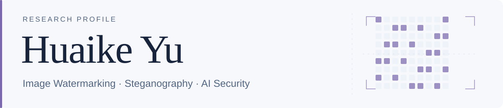
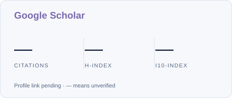

<!-- Layout inspired by awesome-github-profile-readme; original header and Scholar artwork. Generated by scripts/render_readme.py. -->
<h1>
  <picture>
    <source media="(prefers-color-scheme: dark)" srcset="./assets/academic-header-dark.svg">
    <source media="(prefers-color-scheme: light)" srcset="./assets/academic-header-light.svg">
    
  </picture>
</h1>

  
  
  
  

  <strong>Research Assistant</strong> at <strong>Qilu University of Technology (Shandong Academy of Sciences)</strong>. 
  Research guidance: <strong>Qi Li</strong> &nbsp; · &nbsp; Email: <code>huaike.yu[at]unswalumni.com</code>

My research focuses on **invisible image watermarking**, **steganography**, and **AI security**.

## Research overview

<picture>
    <source media="(prefers-color-scheme: dark)" srcset="./assets/scholar-dark.svg">
    <source media="(prefers-color-scheme: light)" srcset="./assets/scholar-light.svg">
    
  </picture>

Google Scholar profile link is being confirmed; unverified citation metrics are shown as —. The six works below include five preprints and one published article.

## Research by topic

### Image watermarking

  <strong><a href="https://arxiv.org/abs/2609.31722">Where Does the Watermark Hide? Push-Pull Disentanglement for Invisible Watermark Removal</a></strong> 
  J. Yang, <strong>Huaike Yu</strong>, Q. Li, C. Wang, Y. Miao, S. Gao, X. Chen 
  2026 · Preprint · arXiv:2609.31722 &nbsp; / &nbsp; Citations: — · <a href="https://scholar.google.com/scholar?q=%22Where+Does+the+Watermark+Hide%3F+Push-Pull+Disentanglement+for+Invisible+Watermark+Removal%22">Scholar</a>

  <strong><a href="https://arxiv.org/abs/2609.01249">One Prompt Is Enough: Watermark Laundering Through Foundation Image Models</a></strong> 
  J. Yang, Q. Li, W. Zong, Y. Chow, W. Susilo, <strong>Huaike Yu</strong>, C. Wang, S. Gao 
  2026 · Preprint · arXiv:2609.01249 &nbsp; / &nbsp; Citations: — · <a href="https://scholar.google.com/scholar?q=%22One+Prompt+Is+Enough%3A+Watermark+Laundering+Through+Foundation+Image+Models%22">Scholar</a>

  <strong><a href="https://arxiv.org/abs/2609.31693">Disentangle and Drop: Robust Universal Removal of Image Watermarks via Reconstructive Grayscale Residual Decomposition</a></strong> 
  Q. Li, J. Yang, F. Fan, Y. Miao, X. Chen, <strong>Huaike Yu</strong>, C. Wang, S. Gao, H. H. Iu, B. Ma 
  2026 · Preprint · arXiv:2609.31693 &nbsp; / &nbsp; Citations: — · <a href="https://scholar.google.com/scholar?q=%22Disentangle+and+Drop%3A+Robust+Universal+Removal+of+Image+Watermarks+via+Reconstructive+Grayscale+Residual+Decomposition%22">Scholar</a>

  <strong><a href="https://www.preprints.org/manuscript/202609.1697">Invisible Image Watermark Attacks: A Survey</a></strong> 
  J. Yang, Q. Li, <strong>Huaike Yu</strong>, X. Wang, C. Wang, B. Ma, S. Gao, J. Wang, X. Li 
  2026 · Preprint · Preprints.org &nbsp; / &nbsp; Citations: — · <a href="https://scholar.google.com/scholar?q=%22Invisible+Image+Watermark+Attacks%3A+A+Survey%22">Scholar</a>

### Steganography

  <strong><a href="https://arxiv.org/abs/2609.22392">Style as Cover: Deep Image Steganography via Stylized Transmission</a></strong> 
  Q. Li, J. Yang, <strong>Huaike Yu</strong>, C. Wang, S. Gao, H. H. Iu, Y. Miao, B. Ma, X. Chen 
  2026 · Preprint · arXiv:2609.22392 &nbsp; / &nbsp; Citations: — · <a href="https://scholar.google.com/scholar?q=%22Style+as+Cover%3A+Deep+Image+Steganography+via+Stylized+Transmission%22">Scholar</a>

### Large language model security

  <strong><a href="https://doi.org/10.54254/2755-2721/93/20240922">Research on adversarial attack and defense of large language models</a></strong> 
  J. Yang, Q. Chi, W. Xu, <strong>Huaike Yu</strong> 
  2024 · Published Article · Applied and Computational Engineering 93 (1), 105–113 &nbsp; / &nbsp; Citations: — · <a href="https://scholar.google.com/scholar?q=%22Research+on+adversarial+attack+and+defense+of+large+language+models%22">Scholar</a>

## Collaborators

Coauthorship across the **6 works listed here** · **17 collaborators**.

| Frequent coauthor | Shared works |
| :-- | --: |
| Jidong Yang | 6 |
| Qi Li | 5 |
| Chunpeng Wang | 5 |
| Suo Gao | 5 |
| Yuantian Miao | 3 |
| Xiao Chen | 3 |
| Bin Ma | 3 |
| Herbert Ho-Ching Iu | 2 |

<strong>Other coauthors</strong>

Xiaoyu Wang · Jinwei Wang · Xiaolong Li · Feng-Lei Fan · Wei Zong · Yang-Wai Chow · Willy Susilo · Qiangyun Chi · Wenqiang Xu

## GitHub & open source

<a href="https://github.com/Huaike-Yu"><picture>
    <source media="(prefers-color-scheme: dark)" srcset="https://github-stats-extended.vercel.app/api?username=Huaike-Yu&amp;show_icons=true&amp;hide_rank=true&amp;hide_border=false&amp;custom_title=GitHub+activity&amp;hide=contribs&amp;title_color=b4a2ed&amp;icon_color=b4a2ed&amp;text_color=a9b9d4&amp;bg_color=101827&amp;border_color=2e3f58&amp;border_radius=12">
    <source media="(prefers-color-scheme: light)" srcset="https://github-stats-extended.vercel.app/api?username=Huaike-Yu&amp;show_icons=true&amp;hide_rank=true&amp;hide_border=false&amp;custom_title=GitHub+activity&amp;hide=contribs&amp;title_color=7a69ae&amp;icon_color=7a69ae&amp;text_color=526580&amp;bg_color=f7f8fc&amp;border_color=d8e1ef&amp;border_radius=12">
    
  </picture></a>

| Repository | Focus | Stars |
| :-- | :-- | :-- |
| [Academic website](https://github.com/Huaike-Yu/Huaike-Yu.github.io) | Personal academic homepage & CV |  |
| [Academic profile](https://github.com/Huaike-Yu/Huaike-Yu) | Research overview & publications |  |

GitHub cards and Stars are refreshed by their badge providers. Profile views is an approximate badge-load counter since installation; repeat loads may count.

## Background & methods

Master’s Degree in **Simulation and Immersive Technologies**, **UNSW** (February 2024 – August 2025).

  <strong>Python</strong> · <strong>Machine Learning</strong> · <strong>Deep Learning</strong> · <strong>Data Analysis</strong> 
  Quantitative and qualitative research · Regression · Classification · Forecasting

<strong>Full education</strong>

- **University of New South Wales (UNSW)** — Master’s Degree in Simulation and Immersive Technologies (February 2024 – August 2025).
- **University of Newcastle** — Bachelor’s Degree in International Business (July 2022 – June 2023).
- **Sichuan International Studies University** — Bachelor’s Degree in Business English (September 2019 – June 2023).

---

[Academic homepage](https://huaike-yu.github.io/) &nbsp; · &nbsp; [Google Scholar](https://scholar.google.com/citations?view_op=search_authors&mauthors=Huaike+Yu&hl=en) &nbsp; · &nbsp; [CV](https://huaike-yu.github.io/assets/Huaike_Yu_CV.pdf)
